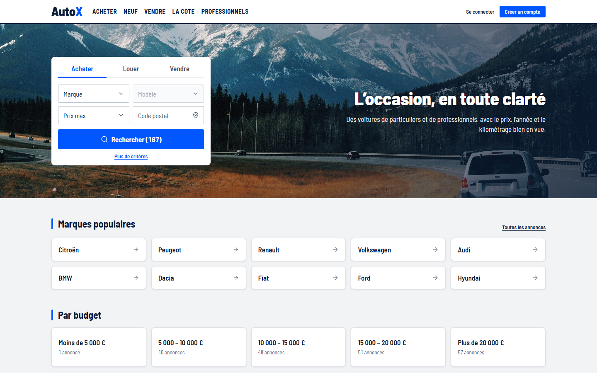
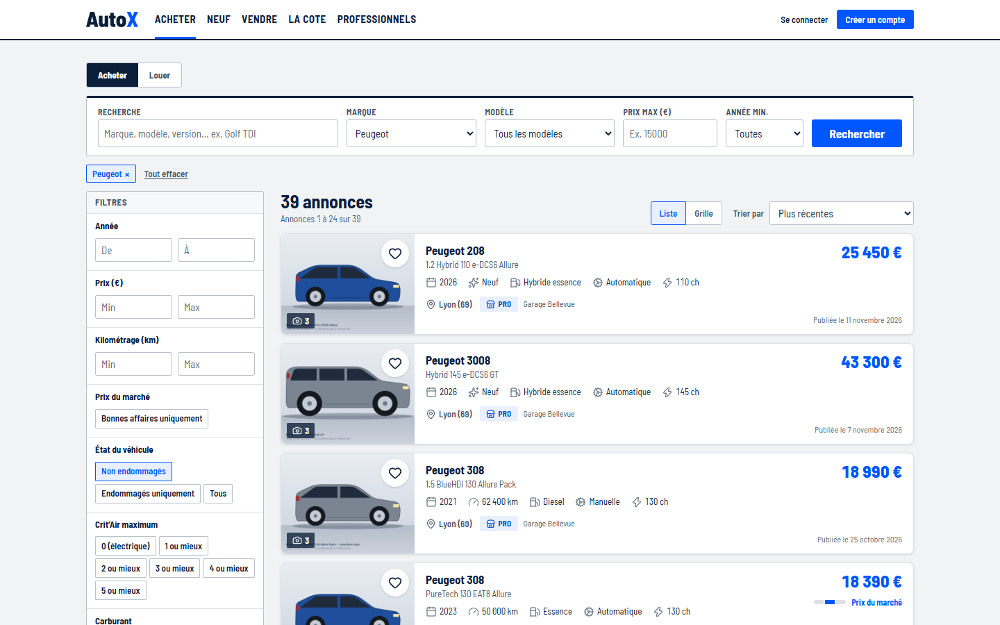
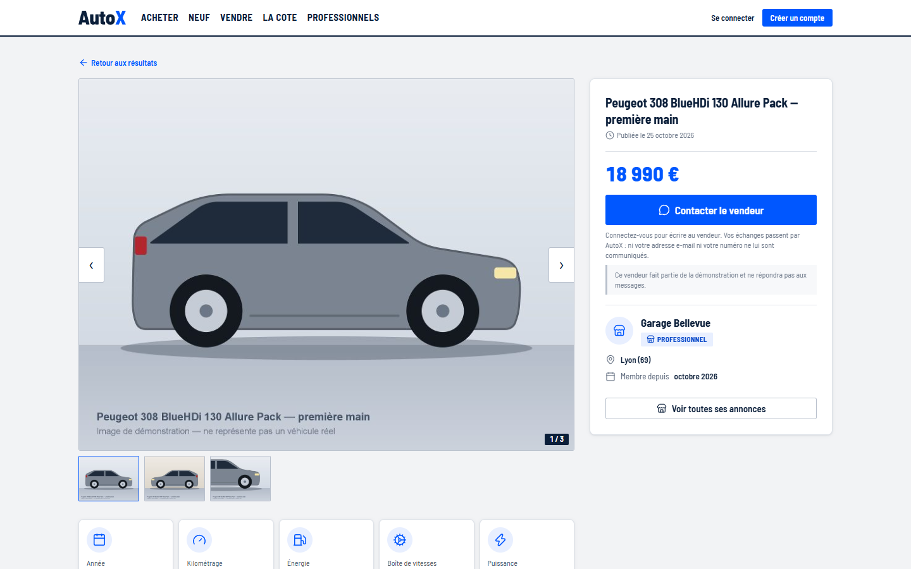
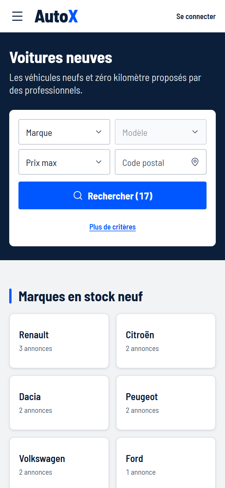
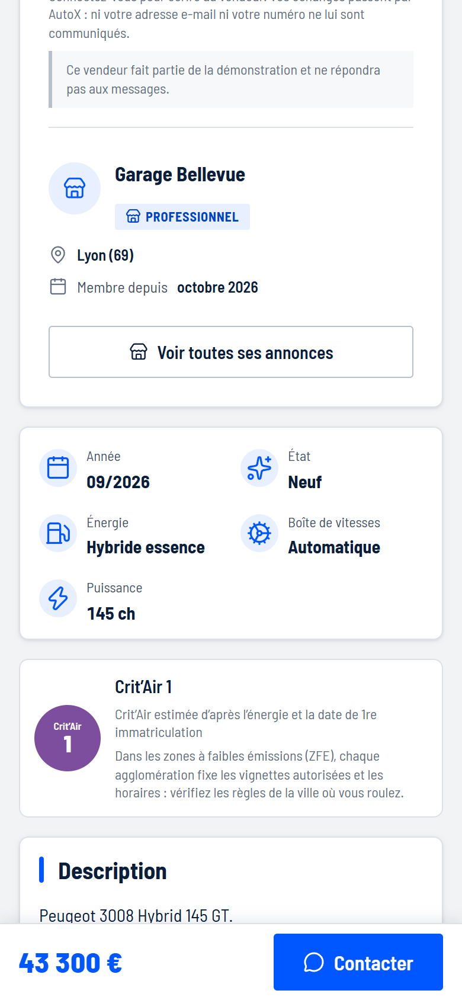
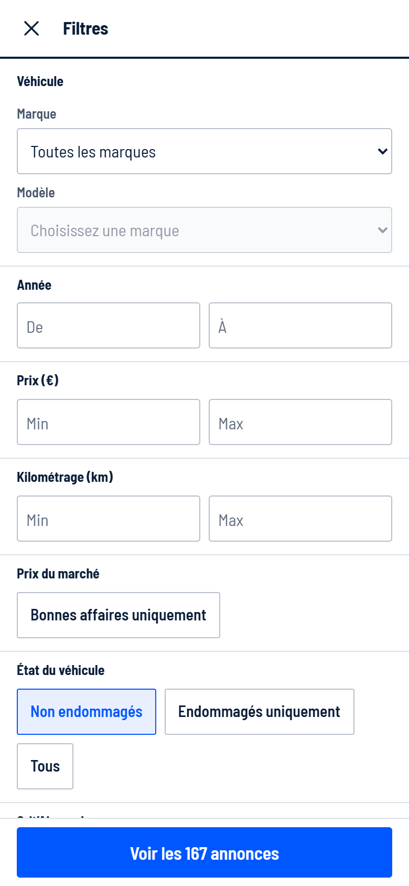
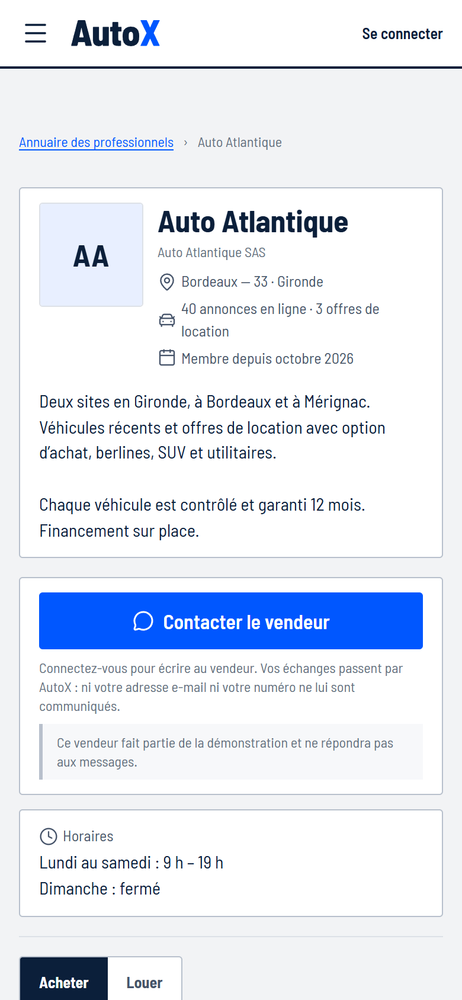
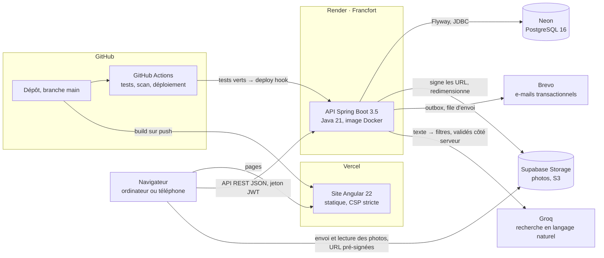

# AutoX

**Démo en ligne : [autox-demo.vercel.app](https://autox-demo.vercel.app)**

> **In English.** AutoX is a car marketplace for the French market:
> - Buying, selling, leasing offers and new cars from dealers.
> - A natural-language search whose output is checked by the server.
> - A price indicator built on comparable listings, and the Crit'Air sticker derived from the
>   official table.
> - Messaging, saved-search e-mail alerts, dealer pages, and an admin dashboard with moderation.
>
> It is built as a portfolio project: a Spring Boot 3.5 / Java 21 API on Render, PostgreSQL on
> Neon and an Angular 22 front end on Vercel. About 3,500 automated tests run in GitHub Actions
> on every push, and deploys are gated on them. The interface is in French; the technical
> documentation in `docs/` is in English.

AutoX est une place de marché automobile pour le marché français : voitures d'occasion et
neuves, particuliers et professionnels, achat et location (LOA, LLD). C'est un projet de
portfolio, réalisé seul, de la base de données au déploiement.

Sur la démo, **les annonces, les vendeurs et les prix sont fictifs** : aucune de ces voitures
n'est à vendre. On peut chercher, filtrer, ouvrir une annonce, créer un compte et publier sa
propre annonce avec photos. Il n'y a **pas de compte de démonstration public** : les vendeurs
de la démo ont des mots de passe aléatoires que personne ne connaît, et le compte administrateur
n'est pas partagé. Le plus simple est de créer un compte, particulier ou professionnel.

L'API tourne sur une instance gratuite qui se met en veille : la première requête après un
moment d'inactivité peut prendre une à trois minutes.

---

## Captures d'écran

| Accueil | Recherche |
|---|---|
|  |  |
| **Annonce** | **Tableau de bord d'administration** |
|  |  |

| Voitures neuves | Annonce neuve | Filtres | Page d'un professionnel |
|---|---|---|---|
|  |  |  |  |

Captures prises avec Playwright sur la pile locale et les données de démonstration, à 1440 px et
à 390 px. La photo de l'accueil est sous licence CC0 (`docs/third-party-assets.md`) ; les photos
des voitures sont des dessins générés, marqués comme tels.

---

## Architecture



- **L'API est la seule à porter des règles.** Le site Angular n'en contient aucune : il appelle
  la même API qu'une future application mobile. Ses modèles TypeScript et ses clients HTTP sont
  **générés** depuis le document OpenAPI de l'API, et un test backend échoue si la copie versionnée
  n'est plus à jour.
- **Les photos ne passent pas par l'API.** Le navigateur les envoie directement au stockage avec
  une URL pré-signée ; l'API vérifie le fichier, retire les métadonnées EXIF et produit trois
  tailles.
- **Aucun e-mail n'est envoyé pendant une requête.** Il est écrit dans une table, dans la même
  transaction que ce qu'il annonce, puis envoyé par une tâche qui réessaie en cas d'échec.

---

## Fonctionnalités

**Chercher**
- Filtres : marque, modèle, prix, kilométrage, année, énergie, boîte, carrosserie, neuf ou
  occasion, Crit'Air maximum, véhicules endommagés, localisation, bonnes affaires.
- Tri, pagination par curseur, nombre de résultats, vue liste ou grille.
- Recherche en langage naturel : « SUV diesel automatique moins de 15 000 € » devient des filtres.
- Recherches enregistrées avec alerte quotidienne par e-mail, favoris, recherches récentes.

**Une annonce**
- Galerie, caractéristiques, équipements.
- Indicateur de prix : bonne affaire, prix du marché ou au-dessus, comparé à des annonces
  comparables.
- Crit'Air estimée d'après l'énergie et la date de première immatriculation.
- Simulateur de financement, annonces similaires, signalement.

**Vendre**
- Dépôt en quatre étapes avec photos.
- Estimation La Cote pendant la saisie du prix.
- Brouillon, publication, pause, renouvellement, vendu.
- Véhicules endommagés, déclarés comme tels.

**Professionnels**
- Annuaire et page de chaque concessionnaire (logo, horaires, contact).
- Offres de location LOA et LLD.
- Section « Neuf » réservée aux voitures neuves vendues par des professionnels.

**La Cote**
- La valeur d'une voiture face aux annonces en ligne, sans publier d'annonce.

**Messagerie**
- Conversations acheteur–vendeur sans échange d'adresses.
- Messages non lus, notification par e-mail, signalement d'un message.

**Comptes et données personnelles**
- Inscription et vérification de l'adresse e-mail.
- Mot de passe oublié, sessions par appareil.
- Export des données, suppression du compte.

**Administration**
- Tableau de bord : activité, tendances, export CSV.
- Modération avant et après publication, avec motif.
- Signalements d'annonces et de messages, gestion des utilisateurs (suspension).

**Pages légales**
- Mentions légales, conditions générales, confidentialité, cookies.

Le site est conçu d'abord pour l'ordinateur et vérifié sur téléphone et tablette (360, 390, 430
et 768 px).

---

## Pile technique

| | |
|---|---|
| **Backend** | Java 21, Spring Boot 3.5.16, Spring Security (JWT HS256, jetons de rafraîchissement rotatifs), Spring Data JPA et JDBC, Flyway (30 migrations), springdoc-openapi 2.10 |
| **Base de données** | PostgreSQL 16 (Neon en production), requêtes de recherche en SQL dont les plans d'exécution sont vérifiés par des tests |
| **Frontend** | Angular 22 (composants autonomes, sans zone.js, signaux), TypeScript 6, client d'API généré par OpenAPI Generator |
| **Tests** | JUnit 5, Testcontainers (PostgreSQL et MinIO réels), MockMvc ; Vitest 5 et jsdom côté site |
| **Services** | Vercel (site), Render (API), Neon (PostgreSQL), Supabase Storage (photos, S3), Brevo (e-mail), Groq (modèle de langage) |
| **Outillage** | Docker Compose en local, GitHub Actions, Trivy, Dependabot |

**Tests : 1 954 côté backend, 1 501 côté site, 30 sur les scripts de build.**
- **Le backend teste contre l'infrastructure réelle.** Tous ses tests d'intégration tournent
  contre un vrai PostgreSQL et un vrai stockage S3, dans des conteneurs. Rien n'est simulé pour
  l'authentification, le SQL ou le stockage.

---

## Intégration et déploiement continus

Deux workflows GitHub Actions, à chaque push, sur chaque pull request et une fois par semaine :

| Workflow | Étapes |
|---|---|
| `backend.yml` | `mvn clean verify` (tous les tests) ; construction de l'image Docker de production ; scan Trivy (échec sur une faille HIGH ou CRITICAL corrigeable) ; puis, sur `main`, appel du deploy hook de Render pour ce commit précis |
| `frontend.yml` | `npm ci` ; audit des dépendances livrées au navigateur ; génération du client d'API ; lint ; tests des scripts ; build ; tests |

**Comment part un déploiement :**
- **L'API** n'est déployée que si le workflow backend est vert. Le déploiement automatique de
  Render est coupé, pour qu'un test rouge ne puisse pas partir en production.
- **Le site** est construit par Vercel à chaque push sur `main`.
- **La base de données** est mise à jour par Flyway au démarrage de l'API.
- **Les dépendances** : Dependabot propose chaque semaine leurs mises à jour, y compris celles
  des images Docker et des actions.

La procédure complète, étape par étape, est dans [docs/deployment.md](docs/deployment.md).

---

## Choix techniques

Les décisions qui méritent d'être lues, chacune documentée avec son pourquoi :

- **[La file d'envoi des e-mails](docs/email.md)** : un e-mail est une ligne écrite dans la même
  transaction que l'action qu'il annonce, puis envoyée par une tâche qui réessaie avec un délai
  croissant. Une panne du fournisseur ne fait échouer aucune requête, et aucun e-mail ne part pour
  une action annulée.
- **[La recherche en langage naturel, validée côté serveur](docs/ai-search.md)** : le modèle
  traduit une phrase en filtres et n'accède jamais à la base. Chaque valeur qu'il renvoie est
  vérifiée par le serveur avant de devenir un filtre. Le prompt a été figé avant de mesurer la
  qualité sur un jeu de requêtes tenu à part, passé une seule fois par modèle.
- **[Le bug des deux horloges](docs/admin-dashboard.md#whose-clock-the-databases)** : le tableau
  de bord comparait des dates écrites par l'horloge de la base à la fin d'une période fixée par
  l'horloge de l'application. Un test qui échouait une fois sur plusieurs exécutions a été reproduit
  de façon déterministe, avec une horloge décalée, avant d'être corrigé.
- **[Pourquoi pas de fiche technique constructeur](docs/weaknesses.md#w16-no-technical-sheet-from-manufacturer-data--decided-against-for-now)** :
  une fiche tirée des données ouvertes de l'ADEME a été étudiée puis écartée. Appariée strictement,
  elle n'aurait couvert que 2,7 % des annonces, car aucune source ne couvre les immatriculations de
  2016 à 2023. Mieux valait ne pas l'afficher que d'afficher une fiche fausse.
- **[La vignette Crit'Air](docs/crit-air.md)** : déduite de l'énergie et de la date de première
  immatriculation par le tableau officiel (arrêté du 21 juin 2016), dans une seule fonction SQL.
  Quand la date ne suffit pas à trancher, rien n'est affiché plutôt qu'une supposition.
- **[Les compteurs des concessionnaires](docs/dealer-pages.md)** : le nombre d'annonces d'un
  professionnel est calculé par les mêmes filtres que la recherche, construits par le même code.
  Un compteur annonçait 36 annonces au-dessus d'une liste de 35 ; ce n'est plus possible par
  construction.

Pour aller plus loin :
- [Les plans de requête mesurés](docs/search-decisions.md).
- [L'indicateur de prix](docs/price-indicator.md).
- [Les jetons et la limitation des tentatives](docs/auth-decisions.md).
- [Les faiblesses connues, classées](docs/weaknesses.md).

---

## Lancer le projet en local

Il faut **Docker** (avec Compose), un **JDK 21**, **Maven 3.9+** et **Node 24.22.1+**. Aucune clé
ni adresse réelle n'est nécessaire : en local, les e-mails sont écrits dans la console et la
recherche en langage naturel est désactivée.

```bash
git clone <URL du dépôt>
cd autox

cp .env.example .env
# Dans .env, renseigner AUTOX_JWT_SECRET avec une clé générée sur la machine :
#   openssl rand -base64 48
# Les mots de passe de la base fournis par .env.example ne servent qu'en local.

docker compose up -d        # PostgreSQL sur le port 5433, MinIO (stockage S3) sur 9000

cd backend
SPRING_PROFILES_ACTIVE=demo mvn spring-boot:run    # l'API sur http://localhost:8081, avec les données de démo
```

Dans un second terminal :

```bash
cd frontend
npm ci
npm start                   # le site sur http://localhost:4200
```

- **Le schéma** est créé par Flyway au premier démarrage.
- **Les données de démonstration** sont créées par le profil `demo` : environ 190 annonces
  fictives avec leurs photos dessinées, des vendeurs, des professionnels. Le profil ne sert
  qu'une fois ; ensuite, `mvn spring-boot:run` suffit.
- **La documentation de l'API** (Swagger UI) est sur http://localhost:8081/swagger-ui.html, active
  en local par `.env.example` et désactivée en production.

Les tests :

```bash
cd backend && mvn clean verify                 # Docker doit tourner
cd frontend && npm run lint && npm test -- --no-watch && npm run build
```

Le guide du développeur, avec les variables d'environnement, la carte des routes de l'API et les
conventions du code, est dans [docs/development.md](docs/development.md).

---

## Documentation

| | |
|---|---|
| [docs/development.md](docs/development.md) | Lancer, tester, configurer ; l'API, ses routes et ses conventions |
| [docs/deployment.md](docs/deployment.md) | Déployer la démo pas à pas : Neon, Supabase, Render, Vercel |
| [docs/weaknesses.md](docs/weaknesses.md) | Les faiblesses du produit classées, et les risques s'il était ouvert au public |
| [docs/deferred.md](docs/deferred.md) | Ce qui n'est volontairement pas construit, et ce que chaque manque coûte |
| [docs/er-overview.md](docs/er-overview.md) · [docs/schema-decisions.md](docs/schema-decisions.md) | Le modèle de données et ses choix |
| [docs/frontend-decisions.md](docs/frontend-decisions.md) | Le client d'API généré, l'authentification côté site, les styles et le responsive |
| [docs/legal-pages.md](docs/legal-pages.md) | Les pages légales et la provenance de chaque information |

Les autres fichiers de `docs/` décrivent chacun une fonctionnalité : messagerie, location,
recherches enregistrées, modération, tableau de bord, voitures neuves, simulateur de financement.
